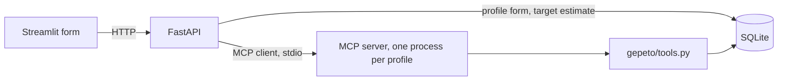
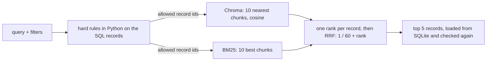

# GePeTo - LLM-powered nutrition assistant

This is our course project for *Understanding and Developing LLMs* (FMI/UBB 2026-2027). It is the first time we build something like this, so a lot of the choices below are our best guess after reading and trying things out. If something looks odd, it probably is a beginner decision and we are happy to change it.

The design is explained in [`docs/RFC.md`](docs/RFC.md) (the idea) and [`docs/MILESTONE_2.md`](docs/MILESTONE_2.md) (architecture and plan).

## Week 7 (9-15 Nov): data, schema, importer, golden dataset

What the plan asked for this week: *Set up the Python app, SQLite schema and importer. Select 300 foods, write 30 recipe records and freeze 60 reviewed evaluation cases. Smoke-test local model loading.*

Here is where each part of that lives in the repo:

| What we did | Where it is |
| --- | --- |
| Import script | [`gepeto/importer.py`](gepeto/importer.py), with the database schema in [`gepeto/schema.sql`](gepeto/schema.sql) |
| List of the 300 chosen foods | [`data/source_manifest.csv`](data/source_manifest.csv), made by [`scripts/select_foods.py`](scripts/select_foods.py) |
| Frozen copy of the foods (per 100 g) | [`data/foods_300.jsonl`](data/foods_300.jsonl) |
| 30 recipes | [`data/recipes.json`](data/recipes.json) |
| Small test data | [`tests/fixtures/`](tests/fixtures/) (a tiny USDA CSV and some user-entered foods, including bad rows on purpose) |
| Golden dataset and dev/test split | [`evaluation/golden.jsonl`](evaluation/golden.jsonl) (36 dev / 24 test), [`evaluation/profiles.json`](evaluation/profiles.json) |
| Checks for all of the above | [`tests/`](tests/), [`evaluation/check_golden.py`](evaluation/check_golden.py) |
| Check that the local model loads | [`gepeto/smoke_model.py`](gepeto/smoke_model.py), output in [`evaluation/runs/smoke_model.json`](evaluation/runs/smoke_model.json) |

## Week 8 (16-22 Nov): profiles, diary, MCP tools and the form UI

What the plan asked for this week: *Implement profile/target setup, diary and nutrient calculations. Expose the core MCP tools and connect the UI. Run deterministic numeric and duplicate-write tests.*

| What we did | Where it is |
| --- | --- |
| Target estimate (Mifflin-St Jeor, activity factor, goal) | [`gepeto/targets.py`](gepeto/targets.py) |
| Profile setup, editable targets, confirmed preference changes | [`gepeto/profiles.py`](gepeto/profiles.py) |
| Diary: meal preview, saving a confirmed preview once, daily summary | [`gepeto/diary.py`](gepeto/diary.py) |
| Keyword food search and rule-based recipe filters (the ranking was replaced in week 9) | [`gepeto/search.py`](gepeto/search.py) |
| The seven core tools as plain functions | [`gepeto/tools.py`](gepeto/tools.py) |
| MCP server (official SDK, stdio) | [`gepeto/mcp_server.py`](gepeto/mcp_server.py) |
| Tool schemas (input and output JSON schemas, as a client sees them) | [`docs/tool_schemas.json`](docs/tool_schemas.json), made by [`scripts/export_tool_schemas.py`](scripts/export_tool_schemas.py) |
| FastAPI app, which is also the MCP host/client | [`gepeto/api.py`](gepeto/api.py), [`gepeto/mcp_host.py`](gepeto/mcp_host.py) |
| Confirmation tokens (only the app can approve a write) | [`gepeto/confirm.py`](gepeto/confirm.py) |
| Form UI: profile and targets, logging meals, day view | [`ui/app.py`](ui/app.py) |
| Golden dev cases run through the real MCP tools | [`evaluation/check_tools.py`](evaluation/check_tools.py), output in [`evaluation/runs/week8_tools.json`](evaluation/runs/week8_tools.json) |
| Numeric, duplicate-write, MCP, API and UI tests | [`tests/`](tests/), output in [`evaluation/runs/week8_pytest.txt`](evaluation/runs/week8_pytest.txt) |

### Run it

```bash
python -m gepeto.importer foods data/foods_300.jsonl      # or the USDA import above
python -m gepeto.importer recipes data/recipes.json
python scripts/seed_profiles.py                           # optional: the 5 fictional profiles

uvicorn gepeto.api:app --port 8000                        # terminal 1: API + MCP host
streamlit run ui/app.py                                   # terminal 2: the form UI
```

If you already have a `gepeto.db` from week 7, it gets upgraded automatically the first time it's opened. After that, run `importer recipes` one more time so the recipes get their ingredient names (we need them for filters like "no mushrooms").

### How the parts connect



The profile form talks to FastAPI directly, since only the user fills it in. Everything the assistant will also do in week 10 (searching, calculating, logging, summarizing) already goes through the MCP server. This way the form tests the same tools, schemas and protections that the chat will use later.

FastAPI starts the MCP server as a subprocess and gives it the profile id and a shared secret through the environment. **No tool takes a user or profile id as an argument**, so the model can't ask about someone else's data. There's a test that checks this on the exported schemas.


### Logging flow

1. **Search** for a food (`search_foods`) or pick a recipe.
2. **Calculate** (`calculate_meal`). It returns calories and macros, unknown fields, rule checks (diet, disliked ingredients, daily kcal target) and a `preview_id`. The preview is stored, but it is added to the diary yet.
3. **Save.** When the user clicks *Save to diary*, FastAPI signs `(profile, preview_id)` with the secret (HMAC-SHA256) and calls `log_meal` with that token and a `request_id`. The model never sees the secret, so it can't confirm its own writes. `update_preferences` works the same way.
4. **Day view** (`get_daily_summary`): the meals, totals, targets and how much is left.

Recipes can be logged by servings, or by cooked grams if the recipe has a `cooked_weight_g`. If it doesn't, the tool says it can't (`missing_data`) instead of guessing.

### MCP tools

| Tool | Writes? | Notes |
| --- | --- | --- |
| `get_profile` | no | Targets, preferences, restrictions. Leaves out age, height and weight on purpose. |
| `get_daily_summary` | no | Unknown values stay `null`, never `0`. |
| `search_foods` | no | Ranked by hybrid retrieval since week 9 (it was a keyword match in week 8). |
| `search_recipes` | no | Hard rules in Python: diet, excluded ingredients, kcal/protein per serving, "fits the rest of my day". The profile's own restrictions always apply. |
| `calculate_meal` | preview only | Foods by grams, or recipes by servings or cooked grams. |
| `log_meal` | yes | Needs an app-issued token. Saving the same thing again never duplicates it. |
| `update_preferences` | yes | Needs a token issued by the app. Repeating the same change does nothing bad. |


Errors have one of these codes: `invalid_input`, `not_found`, `missing_data`, `unconfirmed`, `conflict`, `stale_preview` or `unavailable`. The app uses them to tell a bad quantity apart from missing data or a service that is down.

### How we stop duplicate or unconfirmed writes

- `meal_logs` has `UNIQUE (request_id, item_index)`. If you save with the same `request_id` again, you get `already_logged` and no new rows.
- A preview can only be saved once. If the same preview comes back with a new `request_id` (for example when the model retries), it's reported as already logged.
- Using the same `request_id` for a different meal gives a `conflict`.
- Saving runs inside `BEGIN IMMEDIATE`, so two writers can't both pass the checks.
- If the food data changed after the preview was shown, the preview becomes `stale_preview` and has to be calculated again. Meals that were already saved keep their own nutrient snapshot.
- A meal with several items is saved completely or not at all.
- The UI makes one `request_id` per preview, so double-clicking *Save* or a Streamlit rerun can't save a meal twice.

### Results

```bash
pytest                                # 106 passed, 1 skipped (Ollama)
python evaluation/check_tools.py      # 28 dev cases: numeric 32/32, suggestions 8/8, db changes 4/4
```

`check_tools.py` takes every **dev** golden case that has numbers, recipe constraints or expected database changes and runs it through an MCP client session. The starting diary is created with `calculate_meal` + `log_meal`, the numbers come from `calculate_meal` / `get_daily_summary`, the suggestions from `search_recipes`, and confirmed changes go through `update_preferences`. The tolerance is the same as in week 7 (1 kcal and 0.1 g).

In [`tests/test_diary_numbers.py`](tests/test_diary_numbers.py) the expected values are computed by hand or directly from the JSON data files, not with `gepeto/nutrition.py`. This way a bug in our own arithmetic can't make a test pass by mistake.

### Target estimate

```
resting energy = 10 x kg + 6.25 x cm - 5 x age + 5 (male) / - 161 (female)    [Mifflin-St Jeor]
kcal target    = resting energy x activity factor (1.2 - 1.9) x goal (lose 0.85 / maintain 1.0 / gain 1.10)
protein        = 1.6 g/kg (1.8 g/kg when losing), fat = 30 % of kcal, carbs = the rest
```

The estimate is only available for adults (18-100). If an input is missing, the form tells you which one, and you can type the targets yourself instead. The profile remembers if its targets are the `estimate` or `manual`, and any edit turns them into `manual`. The language model never calls the estimate, and it can only change a target through a confirmed `update_preferences`.

### Known limitations (week 8)

- `search_foods` is a plain keyword match (for example "greek yogurt" also returns tofu yogurt). *Week 9 replaced it with hybrid retrieval.*
- A food's diet check comes from its USDA category. Mixed categories like *Fats and Oils* or *Baked Products* return `unknown`, not `pass`. We don't have allergen data, so a recipe that doesn't contain the word "shrimp" is not proof that it has no shrimp.
- Free-text restrictions we don't understand (for example "low sodium") are not silently ignored. They come back as `unapplied_restrictions`.
- There's no login, because this is a local prototype. The profile selected in the sidebar is the session, and only fictional profiles should be used.
- Previews that were never saved get deleted after a day.

## Week 9 (23-29 Nov): Chroma + BM25 indexes and hybrid retrieval

What the plan asked for this week: *Build the Chroma and BM25 indexes with 200-token chunks and implement hybrid retrieval. Check whether development questions retrieve the expected food and recipe records.*

| What we did | Where it is |
| --- | --- |
| Text cards and 200-token chunks (measured with the embedding tokenizer) | [`gepeto/chunks.py`](gepeto/chunks.py) |
| Embedding model (`all-MiniLM-L6-v2`, pinned revision, normalized vectors) | [`gepeto/embeddings.py`](gepeto/embeddings.py) |
| Building, versioning and publishing the Chroma + BM25 indexes | [`gepeto/index.py`](gepeto/index.py) |
| Hybrid retrieval: 10 dense + 10 BM25 candidates, reciprocal rank fusion, 5 kept | [`gepeto/retrieval.py`](gepeto/retrieval.py) |
| `search_foods` / `search_recipes` ranked by hybrid retrieval | [`gepeto/search.py`](gepeto/search.py), [`gepeto/tools.py`](gepeto/tools.py), schemas in [`docs/tool_schemas.json`](docs/tool_schemas.json) |
| Importer step 4: rebuild the indexes after every import | [`gepeto/importer.py`](gepeto/importer.py) |
| Retrieval check on the dev questions | [`evaluation/check_retrieval.py`](evaluation/check_retrieval.py), output in [`evaluation/runs/week9_retrieval.json`](evaluation/runs/week9_retrieval.json) |
| Chunking, fusion, publishing and retrieval tests | [`tests/test_retrieval.py`](tests/test_retrieval.py), output in [`evaluation/runs/week9_pytest.txt`](evaluation/runs/week9_pytest.txt) |

### Rebuild the indexes

```bash
python -m gepeto.importer foods data/foods_300.jsonl     # step 4 of every import rebuilds the indexes
python -m gepeto.importer recipes data/recipes.json
python -m gepeto.index build                             # or rebuild by hand (--force: even if nothing changed)
python -m gepeto.index status                            # published version, and is it up to date with SQLite?
```

The indexes go to `indexes/` (or `$GEPETO_INDEX_DIR`) and are not committed. The first build downloads the embedding model (about 90 MB) into the Hugging Face cache. After that you can set `HF_HUB_OFFLINE=1` to make sure nothing gets downloaded again. A full build of the 330 records takes about 15 s on a laptop CPU. `importer ... --no-index` updates only SQLite if you want to build the index later.

If you have no index yet, the app still works: the search tools use the week 8 keyword match and say so in `retrieval.method = "keyword_fallback"` with the reason.

### Chunks

- **Foods:** one card per food, never merged with another food. The card has the name, category, preparation state and the values per 100 g, for example `Lentils, raw / Category: Legumes and Legume Products. Preparation: raw. / Per 100 g: 352 kcal, 24.63 g protein, ...`.
- **Recipes:** title, meal type, tags, servings, estimated nutrients per serving, the ingredient list and the steps. A recipe that fits in 200 tokens stays one chunk. If it doesn't fit, the ingredient list stays together in the first chunk and the steps are split at step boundaries with about 30 tokens of overlap. If even the ingredient list is too long, the first chunk becomes a short summary. The full ingredient list is always loaded from SQLite by recipe id before anything is calculated or checked.
- The limit counts word pieces of the embedding model's own tokenizer, title included. The model cuts inputs after 256, so 200 leaves room.

With our data this gives 330 chunks for 330 records. The longest is 143 tokens, so **all 30 recipes fit in one chunk** and the splitting code is only used by the tests (with made-up long recipes). It will matter once longer recipes are imported.

Every chunk keeps its `record_id` (`usda:<fdc_id>` or `recipe:<id>`) as metadata. Search results are mapped back to that record, and the numbers shown always come from SQLite, never from the indexed text.

### How a search works



1. For recipes, the hard rules (diet, excluded ingredients, kcal and protein per serving, the profile's own restrictions) are checked first on the full SQL records. The ids that pass become a metadata filter for **both** retrievers. That way similarity can only change the order of recipes that are allowed, and an allowed recipe can't be pushed out of the top 10 by one that isn't. For foods, `prep_state` is a metadata filter in the same way.
2. Chroma returns the 10 nearest chunks (cosine distance on normalized `all-MiniLM-L6-v2` vectors), and BM25 (`k1 = 1.5`, `b = 0.75`, our own small tokenizer that folds plurals and drops numbers and stop words) returns its 10 best chunks.
3. Each list is reduced to one rank per record, so a recipe with several chunks is counted once per list. Then reciprocal rank fusion adds `1 / (60 + rank)` from each list. Ties go to the better dense rank, then the better BM25 rank, then the record id, so the same query always gives the same order.
4. The top 5 records are loaded from SQLite. Recipes are checked against the rules one more time (`recheck_dropped` says if one ever failed; it should always be empty).

Every result now has a `match` with its dense rank, BM25 rank, cosine similarity, matched words and chunk ids. Every search returns `retrieval` with the method, the index version and `index_up_to_date`. In week 10 this lets the agent notice a weak match, and lets us debug wrong answers.

### Index versions

A build writes a new version folder (`indexes/v0003/`) next to the published one. Only when the Chroma collection and the BM25 file are both written and read back correctly does the `indexes/CURRENT` file get switched to the new version, in one atomic rename. If the build fails halfway, `CURRENT` still points to the old version, and the half-built folder is removed by the next build. Running MCP servers check `CURRENT` on each search, so they move to the new version without a restart. We keep the previous version and delete older ones.

Rebuilds are incremental. A chunk whose text didn't change reuses its vector, only new or changed chunks are embedded, and chunks of records that changed or disappeared are not carried over. If nothing changed at all, no new version is published. For example, when the kcal value of raw chicken breast changes, the next build embeds 1 food card + the 2 recipes that use chicken breast (their per-serving line changed) and reuses the other 327 vectors. There's a test for exactly this.

The manifest of each version records the model name and revision, the chunk settings, the retrieval settings and a fingerprint of the SQL data. If the data changed after the build, searches still work but report `index_up_to_date: false`, and the UI shows a hint to rebuild.

### Results on the dev questions

```bash
python evaluation/check_retrieval.py    # dev split only -> evaluation/runs/week9_retrieval.json
```

21 of the 36 dev cases need retrieval: they require `search_foods` or `search_recipes` and list relevant source ids (11 about foods, 10 about recipes). The daily summary cases also list source ids, but those are the meals already in the diary, so they are not retrieval questions. The checker builds a fresh database and index, sends each question, maps the chunks to records and compares the first five with the annotated ones.

| Setting | Recall@5 | Recall@5, capped | Hit@5 | MRR@5 | relevant records found |
| --- | --- | --- | --- | --- | --- |
| Question only, dense | 0.839 | 0.844 | 21/21 | 0.748 | 24/41 |
| Question only, BM25 | 0.784 | 0.798 | 18/21 | 0.809 | 28/41 |
| **Question only, hybrid** | **0.862** | **0.870** | **21/21** | **0.829** | 26/41 |
| Question + constraints, through the MCP tools (hybrid) | 0.949 | 0.976 | 21/21 | 0.929 | 36/41 |

- **Question only** sends the raw user question, restricted only to foods or recipes. We ran dense, BM25 and hybrid on the same questions to compare them. Hybrid has the best recall and MRR, and it finds something relevant for every question. BM25 alone misses 3 of the suggestion questions completely (for example "high-protein lunch" shares no useful word with the right recipe).
- **Through the tools** sends the same question to `search_recipes` / `search_foods` together with the structured constraints from the case (meal type, diet, kcal, protein, excluded ingredients). This is how the agent will call them in week 10. All 8 suggestion cases return only acceptable recipes.
- **Capped** recall divides by `min(relevant, 5)`. Two preference cases accept 7 recipes, so plain Recall@5 can be at most 5/7 there.

What it still gets wrong:

- *"80 g of dry oats cooked with 250 g of whole milk"* is one question about two foods. Oats come first, but milk is 6th. The agent should search once per food, which we'll check in week 10.
- *"How many calories and grams of protein are in 100 g of raw chicken breast?"*: the right record is 2nd, after *ground* chicken. The full question is mostly words about nutrients that every food card contains, and that throws off the dense ranking. The short query "raw chicken breast" puts it first (there's a test for that).
- *"How much vitamin D is in raw salmon?"*: salmon is 2nd. Whole milk comes first because its USDA name contains "with added vitamin D".
- With only the question (no constraints), "dinner under 500 kcal" type questions can't work well, because numbers aren't similarity. That's expected, and it's why the rules are applied in Python. With the constraints, these cases are correct.
- For a food we don't have (*"a Big Mac"*, *"2 slices of pizza"*), retrieval still returns the closest cards (soft pretzels, popcorn cakes) with low similarity (0.46 and 0.23) and no matched words. Deciding that none of them is the asked food is the agent's job in week 10. These two cases are listed separately in the output.

These are dev results on 21 cases, measured after looking at them, so they are not the held-out result. The test split was not run.

### Known limitations (week 9)

- The embedding model is small and English-only. We haven't tried others yet, and we won't switch without measuring.
- BM25 uses a very simple tokenizer (lowercase, plural folding). "Low-fat" and "lowfat" are still different words.
- Each MCP server process loads its own copy of the embedding model (about 550 MB of RAM with PyTorch, measured on our laptop). That's fine for a few local profiles, but not for many at once. The first search in a new server can take a few seconds while the model loads, so the server starts loading it in the background right away.
- The keyword fallback without an index is only a safety net, and its ranking is the weak week 8 one.

## Setup

```bash
python -m venv .venv && source .venv/bin/activate
pip install torch==2.15.0 --index-url https://download.pytorch.org/whl/cpu   # optional: CPU-only PyTorch, much smaller
pip install -e ".[dev]"          # MCP SDK, FastAPI, Streamlit, Chroma, sentence-transformers, BM25 (pinned) + pytest
```

If you are new to this like us: the first line makes a separate Python environment so nothing gets installed globally, and the last one installs our package plus pytest. The middle line is only needed if you don't have a GPU: without it pip downloads the much bigger CUDA build of PyTorch.

## Reproduce the data

```bash
python scripts/download_usda.py   # SR Legacy 2018-04 zip (CC0), sha256-checked -> data/raw/ (not committed)
python scripts/select_foods.py    # -> data/source_manifest.csv, data/foods_300.jsonl (deterministic)

python -m gepeto.importer usda data/raw/FoodData_Central_sr_legacy_food_csv_2018-04 --manifest data/source_manifest.csv
python -m gepeto.importer recipes data/recipes.json
python -m gepeto.importer foods tests/fixtures/user_foods.json   # example user-entered foods: 2 ok, 4 rejected
```

The database is saved to `gepeto.db` (or wherever `$GEPETO_DB` points) and we don't commit it. If you run an import twice you should see `unchanged=300` the second time, which means nothing got duplicated.

### What the importer does

We split the import into steps, so it is easier to understand and to test:

1. **Validate.** A description and a source id are required, and user-entered foods also need a `source_note`. Numbers can't be negative, the unit has to be `kcal` or `kJ`, and a serving needs its weight in grams. Rows that fail are printed together with the reason.
2. **Normalize.** Everything is converted to kcal and grams per 100 g. kJ is divided by 4.184, and a per-serving label is scaled by `100 / serving_g`. If a nutrient is missing we store `NULL`, not `0`, because "unknown" and "zero" are not the same thing.
3. **Upsert** (insert or update). Rows are matched by `(source, source_id)`. If the content hash is the same the row is skipped, and if it changed the row is updated and `version` goes up by one. Every run is written to the `import_runs` table.

4. **Index.** Since week 9 the importer then rebuilds the search cards, their embeddings and the BM25 index, and publishes the new index version only when both are ready (see [Week 9](#week-9-23-29-nov-chroma--bm25-indexes-and-hybrid-retrieval)).

A few other things we decided:

- `prep_state` (`raw` / `cooked` / `unspecified`) is guessed from words in the USDA description, so raw and cooked foods stay separate records.
- `meal_logs` store a snapshot of the nutrients and a `food_version`, so importing new data later can't change totals from earlier days.
- `request_id` is `UNIQUE`, so the same request can't log a meal twice. (Since week 8 a meal can have several items, so the constraint is `UNIQUE (request_id, item_index)`.)

### How the 300 foods were chosen

[`scripts/select_foods.py`](scripts/select_foods.py) starts with the 68 ingredients used in our recipes. Then it fills a fixed quota for each USDA category (dairy 35, vegetables 50, fruit 40, ...) using the foods with the shortest descriptions, and ties are broken by `fdc_id`. It skips baby food, brand names and any food that is missing kcal, protein, carbs or fat. The `reason` column in the manifest says why each food was picked.

## Golden dataset

The golden dataset is a fixed set of questions with known correct answers that we will use later to test the assistant. We wrote 60 cases, 10 for each of these categories: `food_lookup`, `portion_calculation`, `daily_summary`, `constrained_suggestion`, `preference_change` and `ambiguous_unsupported`.

Each category has 6 dev cases and 4 held-out cases (marked `"split": "test"`). Cases that share a `scenario` (they are paraphrases of each other) always go in the same split, so the test set doesn't leak into the dev set. All profiles are fictional.

Every case has: `turns`, `profile_id`, `diary`, `expected_behaviour`, `expected_facts`, `acceptable_recipe_ids`, `relevant_source_ids` (`usda:<fdc_id>` / `recipe:<id>`), `required_actions`, `forbidden_actions`, `expected_db_changes`, plus `calc` / `constraints` so the expected answer can be recomputed.

```bash
python evaluation/check_golden.py   # 60 cases, Counter({'dev': 36, 'test': 24}), 0 problems
```

The checker loads the frozen data into an in-memory database and recalculates every number with `gepeto/nutrition.py` (allowed error: 1 kcal and 0.1 g). It also rebuilds the list of acceptable recipes for each suggestion from the stated constraints, and checks the counts, the split, scenario leaks and that every source id exists.

**The split is frozen from now on.** We will tune on `dev` and run `test` only once, in week 12.

## Tests

```bash
pytest                                   # 134 passed, model test skipped (output: evaluation/runs/week9_pytest.txt)
GEPETO_RUN_MODEL_TESTS=1 pytest          # + live Ollama test
```

## Model smoke test

```bash
ollama pull qwen2.5:3b
python -m gepeto.smoke_model --out evaluation/runs/smoke_model.json
```

Result (14 Nov 2026): we used `qwen2.5:3b`, a small model that runs on a normal laptop. It loaded in about 3.8 s and gave back valid JSON that picked `search_foods` for "200 g of raw chicken breast". This only shows that the model loads and can output JSON, it is **not** an evaluation of the model.

## Known limitations (week 7)

- Picking by "shortest description" sometimes selects unusual foods (emu, ostrich, acorns). They are valid records, just not very common ones.
- The `prep_state` guess is based on words, so for example "canned" counts as cooked.
- Recipe nutrients are **estimates**, summed from raw ingredient weights. Only 4 recipes have a `cooked_weight_g`, which is needed to log by cooked grams.
- The golden cases are checked by a script against the frozen data.
