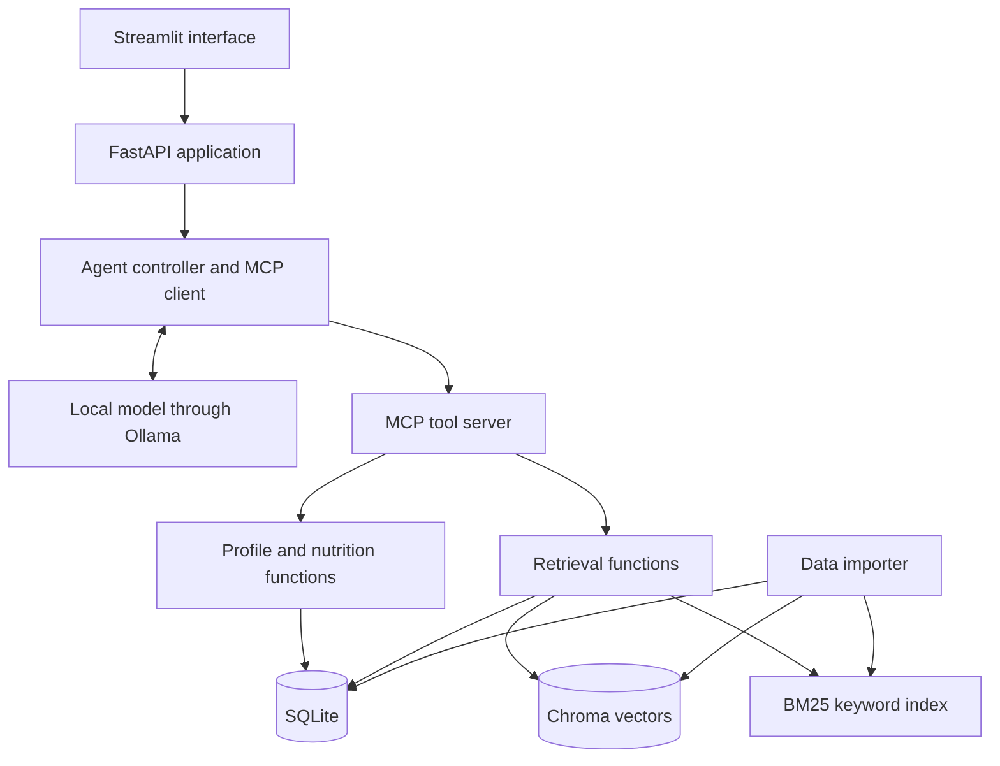
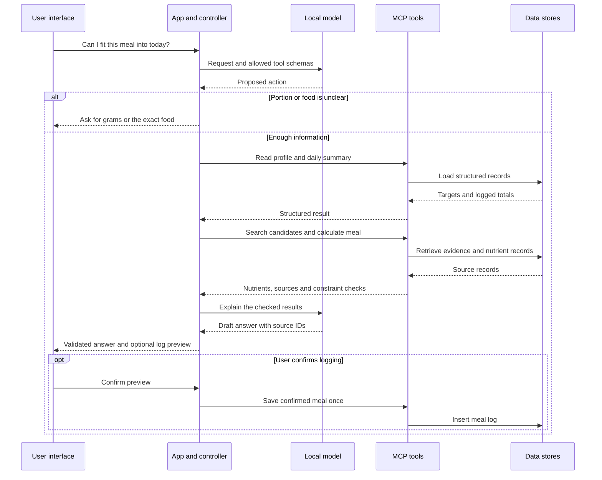

# Milestone 2: Architecture and Project Plan

**Project:** GePeTo - LLM-Powered Nutrition Assistant  
**Date:** 3 November 2026  
**Status:** Proposed design, based on our RFC. Everything below (implementation and experiments) is planned work. We have not run any of it yet, so we are not reporting results.

## 1. What we want to build

Our app should help users log what they eat and decide what to eat next. A user should be able to ask "Does this meal fit my day?" and get a short answer that takes into account their targets, their previous meals and their preferences. This is the same scope as in our RFC: profiles, food logging, calorie and macronutrient tracking, and basic recommendations.

For the first version we keep things simple: English text input and quantities in grams. The interface will have a profile form, a daily food diary and a chat. For suggestions we will use a small collection of recipes.

The main design decision, and the one we are most unsure about, is to keep **calculations separate from text generation**. From what we have read, language models can write nice explanations but are not reliable at arithmetic. So Python will calculate portions and daily totals from stored values, and the language model will only choose which tool to use and explain the result. We hope this makes wrong numbers easier to spot and fix than if we asked the model to do everything.

## 2. Data and ingestion

### Initial dataset

We will use **USDA FoodData Central, SR Legacy, April 2018**, which can be downloaded as CSV files. We picked this fixed release because it gives us a reproducible starting point, with food identifiers and nutrient values. It is not an up-to-date catalogue, and it is certainly not a list of products from Romanian supermarkets, so we know it has limits. FoodData Central publishes its data under CC0, so we can use it freely.

We will start with a documented selection of **300 foods** covering meat, dairy, grains, legumes, fruit, vegetables, oils and common snacks. The selection script and the list of source IDs will be committed so that anyone can reproduce the same subset. We will also write **30 simple recipes**, each with ingredient IDs, quantities in grams, preparation steps and a number of servings. The nutrients of a recipe are calculated from its ingredients and marked as estimates.

Each food record keeps its source ID, description, preparation state, calories, protein, carbohydrates and fat per 100 g, the source version and the import date. A missing value stays `null` and does not become zero, because not knowing a value is different from the value being zero. Raw and cooked foods are kept as separate records (for example, 100 g of raw rice and 100 g of cooked rice are very different). A recipe says whether its ingredient weights are raw or cooked. If a user wants to log a recipe by cooked grams instead of servings, the recipe also needs a final cooked weight.

### Adding new data

The importer will accept FoodData Central CSV files and our own food/recipe JSON format. A packaged food entered by hand needs a name, the values from the label, units and a source note, and it stays marked as user-entered data.

The import process will:

1. Validate the required fields, units and non-negative quantities, and report the rows it rejects.
2. Normalize nutrient values to 100 g. A serving is only converted when its weight in grams is known.
3. Insert or update records by source and source ID, comparing a content hash so unchanged records are skipped.
4. Create searchable text cards and update their embeddings, remove superseded chunks, and rebuild the small keyword index.

A new index version will only be published once its SQL records and both search indexes are ready. Until then the app keeps using the previous version. Running an import again should not create duplicates. Meal logs keep the food version and the nutrient snapshot that were used when the meal was saved, so an import can't silently change yesterday's totals.

Profiles and meal logs stay in SQLite, outside the shared retrieval corpus. For evaluation we only use fictional profiles. Real personal data, model weights and generated databases will not be committed to GitHub.

## 3. Proposed architecture

The diagram below shows how the parts connect. We will explain each part right after it.

We chose **Streamlit** for the interface because it lets us build a UI in Python quickly, so we can spend more time on retrieval and evaluation than on frontend work. **FastAPI** will hold the chat endpoint, the input validation and the agent controller. Keeping it as its own layer means we can test the backend without clicking through the interface. This is a local prototype, so the UI, the API, the MCP server and the model runner can all run on the same machine.

**SQLite** is the source of truth for profiles, food versions, recipe ingredients and meal logs. **Chroma** stores embeddings (numbers that represent the meaning of a text), together with the text and its source metadata. We picked it because its persistent client and metadata filters fit a small local project. **BM25** gives us a second way to search the same text cards, based on exact words.

Profile setup will offer a target estimate computed by fixed formulas, not by the model: Mifflin-St Jeor resting energy expenditure, a configurable activity factor and an adjustment for the goal. We will label the result as an estimate and let users edit their calorie and macro targets. If an input needed by the equation is missing, the user can type their targets manually. The language model will never invent or silently change targets. This is a general food-tracking prototype and not something that prescribes medical diets.

### Example request flow

This diagram follows one question from the user to the answer.

Asking about a food will not log it automatically. If the food or the portion is ambiguous, the app asks a clarification question. Before showing a recommendation, it checks the ingredient restrictions and compares the numbers in the answer with the tool results. If this validation fails, it falls back to showing the checked calculation in a simple template.

## 4. RAG design

RAG (retrieval-augmented generation) means that before the model answers, we first look up relevant records and give them to it, so it answers from our data and not from memory.

### Chunking and embeddings

For food records we will create **one short text card per food**, with its name, preparation state, category and values per 100 g. Different foods will never be merged into the same chunk. For recipes, we keep the ingredient list together as one unit and split longer instructions at step boundaries. Each chunk keeps its recipe ID and title. When a recipe is retrieved, we load its complete structured ingredient list before calculating anything or checking restrictions.

We will start with a limit of **200 tokens per chunk**, measured with the embedding tokenizer and including the title. Longer instruction text gets an overlap of about **30 tokens** between chunks. Short food cards stay whole. If an ingredient list is too big, we retrieve a short recipe summary and expand it by recipe ID, instead of cutting the list in the middle.

For embeddings we will use **`sentence-transformers/all-MiniLM-L6-v2`**. It produces 384-dimensional vectors and, by default, cuts inputs after 256 word pieces, but our small chunks should stay under that. It seems like a reasonable first choice for an English prototype. We don't want to assume that a bigger embedding model is needed without measuring first, so we will check retrieval quality ourselves. We will use normalized embeddings and cosine distance in Chroma.

### Hybrid retrieval

We will use **hybrid RAG**, which combines dense retrieval (searching by meaning with embeddings) and BM25 keyword search. Dense retrieval helps match what a request means, and BM25 helps find exact food and ingredient names. We think this combination suits our data, since users may describe a meal in different words or ask for one specific ingredient.

The system will retrieve ten dense and ten BM25 candidates, merge them with reciprocal rank fusion, and keep five unique results. With this method, each list adds `1 / (60 + rank)` to a candidate's score, where ranks start at 1. Recipe matches are expanded to their full records, and duplicate recipes are removed before generation. We will evaluate this hybrid pipeline on the Golden Dataset.

Restrictions are applied through metadata and then checked again against the complete ingredient records. If allergen information is missing, we do not treat it as proof that a food is safe. Numeric conditions such as "under 600 kcal" are checked in Python and not treated as semantic similarity.

The prompt will contain the question, the relevant profile fields, the daily totals, the tool results and the IDs of the retrieved sources. The answers should cite the records they use. Retrieved text is treated as data and never as instructions. If no supported candidate meets the request, the app should say so or ask the user to relax a constraint.

## 5. Agent and MCP tools

MCP (Model Context Protocol) is a standard way to expose tools to a language model. The model does not run code itself, it asks for a tool and our program runs it.

We will build **one agent with a bounded tool loop** and not several specialized agents, since one is simpler for us to build and debug. The agent decides whether the user wants to search for a food, calculate a meal, see their day, get a suggestion or change a preference. It also decides when to ask for clarification and whether another search would help.

The controller only accepts actions that match the schema and are on an allowlist, with at most six tool calls per request. If an action is malformed, the model gets one attempt to repair it, and repeated failures or timeouts return a clear message. The application handles user confirmation itself, so the model can't approve its own writes.

| MCP tool | Main inputs | Result or effect |
| --- | --- | --- |
| `get_profile` | None; the session supplies the user | Targets, preferences and restrictions. |
| `get_daily_summary` | Local date | Logged meals and calculated totals. |
| `search_foods` | Query, filters, limit | Food candidates with IDs, preparation state and sources. |
| `search_recipes` | Query, restrictions, limit | Retrieved recipes with source IDs; the final nutrient checks stay deterministic. |
| `calculate_meal` | Food IDs and grams, or recipe ID and servings | Calories and macros, unknown fields, and rule checks. It does not write anything. |
| `log_meal` | Validated preview ID, application confirmation token, request ID | Saves the confirmed meal; a repeated request ID can't duplicate it. |
| `update_preferences` | Validated change and application confirmation token | Saves an explicitly confirmed preference, such as disliking mushrooms. |

We will expose these Python functions through the **official MCP Python SDK**, with JSON schemas and structured JSON results. FastAPI acts as the MCP host/client and starts the server as a local subprocess over **stdio**. MCP standardizes how our tools are accessed, but we still need our own controller to interpret and validate what the model proposes.

The server gets the user from the trusted session and never accepts a user ID from the model. Tool errors will tell apart missing data, invalid quantities and unavailable services. Dataset imports are a separate developer command and not a chat tool.

## 6. Model choice

We will use **Qwen2.5-3B-Instruct** as the language model, in a quantized version (compressed so it needs less memory) running locally through Ollama. We chose it because it is small enough to run on our own computers, and because it supports structured output, which fits the JSON actions our agent controller expects.

The model interprets requests, selects tools and writes short explanations from their results. Calculations and validation stay in Python. We will write down the exact model version, quantization and prompt settings so that others can reproduce our setup. We will test whether the model picks the right tools, respects the user's restrictions and uses the supplied food records correctly.

## 7. Golden Dataset and evaluation

The Golden Dataset is a set of test cases where we already know the right answer, so we can check the system against it.

We will create **60 manually reviewed cases** in `evaluation/golden.jsonl`: ten each for food lookup, portion calculations, daily summaries, constrained suggestions, preference changes, and ambiguous/unsupported requests. Some of them will be short multi-turn conversations. Each case includes a fictional starting profile and diary, the question, the expected facts or acceptable recipe IDs, the relevant source IDs, required and forbidden actions, and the expected database changes.

One team member writes a case and another checks it against the frozen source data and calculates the numeric answers independently. An LLM may suggest wording for questions, but its output will not be used as the reference answer. Recommendation questions can have several valid answers, so we will score whether the chosen recipe meets the constraints and whether its explanation is supported.

We will split the cases into **36 development cases and 24 held-out cases**, with six and four from each category. Paraphrases and variants of the same scenario stay in the same split. The reference answers will never be put into the retrieval corpus. We freeze the split in Week 7 and use the development cases for prompt and retrieval changes. The held-out set is run after we have chosen our configuration, in Week 12. Fixes and reruns after that will be labelled as such, and we won't present them as a fresh unseen test.

### Example cases

These numbers and IDs are **synthetic test fixtures**, not real USDA measurements. The finished dataset will also have cases linked to real imported records.

| Question and starting state | Expected answer or behaviour |
| --- | --- |
| "What are the calories and protein in 200 g of `test_food_01`?" Fixture: 165 kcal and 31 g protein per 100 g. | 330 kcal and 62 g protein, citing the fixture record. |
| "How many calories do I have left?" Target: 2,000 kcal; logged: 1,450 kcal. | 550 kcal remaining; the diary is not changed. |
| "Suggest a vegetarian dinner below 600 kcal with at least 25 g protein." Fixture recipe A: 520 kcal/30 g, vegetarian; B: 650 kcal/35 g; C: 480 kcal/32 g, contains chicken. | Suggest A. B fails the calorie limit and C fails the dietary constraint. |
| "I ate a bowl of rice." No weight or preparation state given. | Ask for the portion size and whether it was cooked; do not invent a precise total or save a meal yet. |
| "I dislike mushrooms; remember that." Then confirm the change and ask for dinner. | Save the preference only after confirmation; leave out mushroom recipes in the later answer. |
| "How much vitamin D is in `test_food_02`?" That nutrient is missing. | Say that the value is unavailable; do not return zero. |

### Evaluation procedure

We will test the hybrid RAG pipeline together with Qwen2.5-3B-Instruct on the development cases, fix wrong retrieval, wrong tool calls and unsupported answers, and then freeze the configuration for the held-out evaluation in Week 12. The experiments will cover portion calculations, ambiguous inputs, dietary restrictions, preference updates and newly imported foods. We will record the expected and the actual results and explain the main failures.

We plan to report:

- **Retrieval Recall@5:** the fraction of the annotated relevant source records that appear in the first five results, averaged over the cases that need retrieval. Chunks are mapped back to their source records.
- **Numeric correctness:** the percentage of numeric cases where all required values are within 1 kcal and 0.1 g of the independently calculated reference, allowing for display rounding.
- **Task success:** correct tool use, expected state changes, satisfied constraints and appropriate clarification. We will also review the quality of recommendations by hand.
- **Grounding:** whether factual claims are supported by the cited records, including checks for invented sources and for claims about missing data.

Our first goals are at least **80% Recall@5**, **95% numeric correctness** and **80% task success** on the applicable held-out cases, with **zero unconfirmed writes and zero recommendations with prohibited ingredients in the test set**. These are targets, not measured results, and they say nothing about cases outside the set. We will publish the raw counts together with the percentages, because 24 held-out cases is a small sample.

## 8. Week-by-week implementation plan

The dates follow the FMI/UBB 2026-2027 calendar. We are currently in **Week 6**. Week 12 ends before the Christmas break, and Weeks 13-14 are in January. The exact submission and presentation slots are the ones set in class.

| Week | Dates | Work and experiments | Evidence to commit by the end of the week |
| --- | --- | --- | --- |
| **6 - Milestone 2** | **2-8 Nov 2026** | Finalize the architecture, dataset choice, evaluation design and scope. | This document and diagrams in `docs/`; implementation tasks with owners. |
| **7** | **9-15 Nov** | Set up the Python app, SQLite schema and importer. Select 300 foods, write 30 recipe records and freeze 60 reviewed evaluation cases. Smoke-test local model loading. | Import script, source manifest, small fixtures, golden dataset/split and basic validation tests. |
| **8** | **16-22 Nov** | Implement profile/target setup, diary and nutrient calculations. Expose the core MCP tools and connect the UI. Run deterministic numeric and duplicate-write tests. | Working form-based logging flow, MCP server, tool schemas and test output. |
| **9** | **23-29 Nov** | Build the Chroma and BM25 indexes with 200-token chunks and implement hybrid retrieval. Check whether development questions retrieve the expected food and recipe records. | Hybrid retrieval code, rebuild instructions and retrieval correctness results. |
| **10** | **30 Nov-6 Dec** | Connect bounded agent routing, clarification and confirmed writes. Integrate Qwen2.5-3B-Instruct with hybrid RAG and test complete user conversations. | End-to-end chat flow, sanitized tool traces and development test results. |
| **11** | **7-13 Dec** | Test restrictions, unsupported questions, preference changes and import updates. Fix wrong answers and tool calls, then freeze the demo configuration. | Correctness test results, resolved issues, failure examples and frozen configuration. |
| **12 - Progress review** | **14-20 Dec** | Run the frozen held-out evaluation, fix anything that blocks the demo and prepare a reproducible local demo. | Working prototype, setup guide, evaluation report/raw outputs and a tagged progress version. Any fixes and reruns after the test are recorded separately. |
| Christmas break | 21 Dec 2026-3 Jan 2027 | Buffer for optional cleanup; no essential feature depends on holiday work. | Optional fixes only. |
| **13** | **4-10 Jan 2027** | Address feedback, improve the most common failures and check the installation from a clean checkout. | Tracked fixes, labelled regression results and final demo script. |
| **14 - Final presentation** | **11-17 Jan 2027** | Present the system, the experiments, the trade-offs and the remaining limitations. | Final report, presentation materials and tagged final version. |

The main risks we see are limited hardware, ambiguous food entries and trying to do too much on the interface. If we fall behind, we will cut interface polish and postpone extra recipe features. The core commitment is profiles, reliable logging, MCP tools, one working RAG path and reproducible evaluation. We will report any remaining wrong answers and limitations honestly, and since this is our first project of this kind, we expect to learn and adjust the plan as we go.
