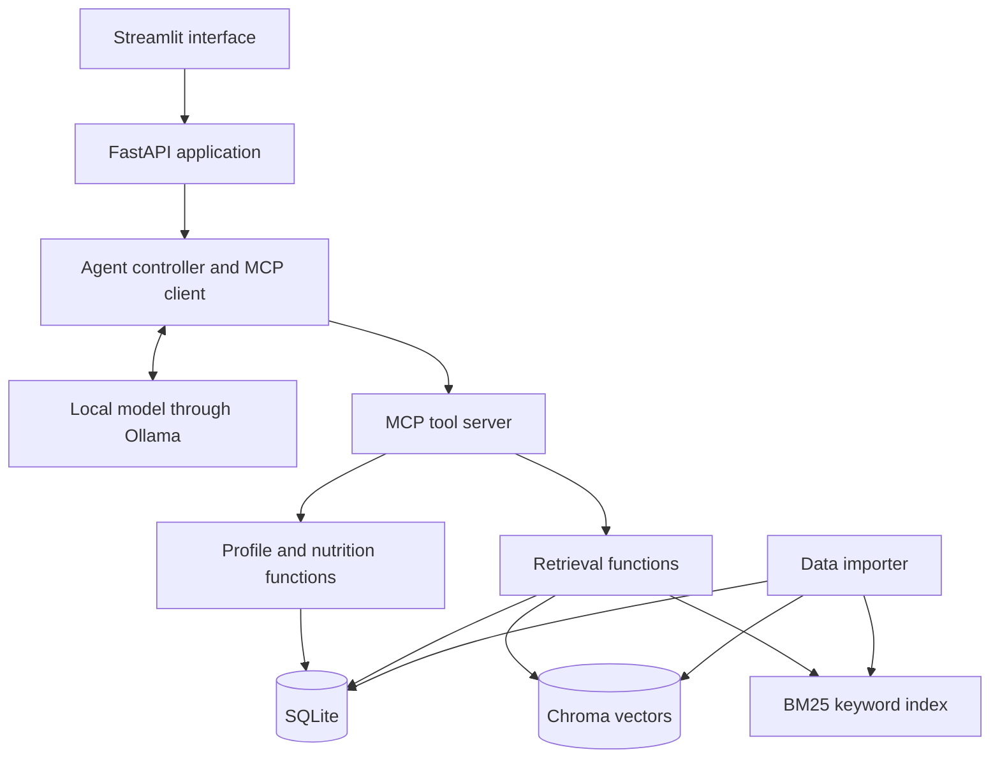
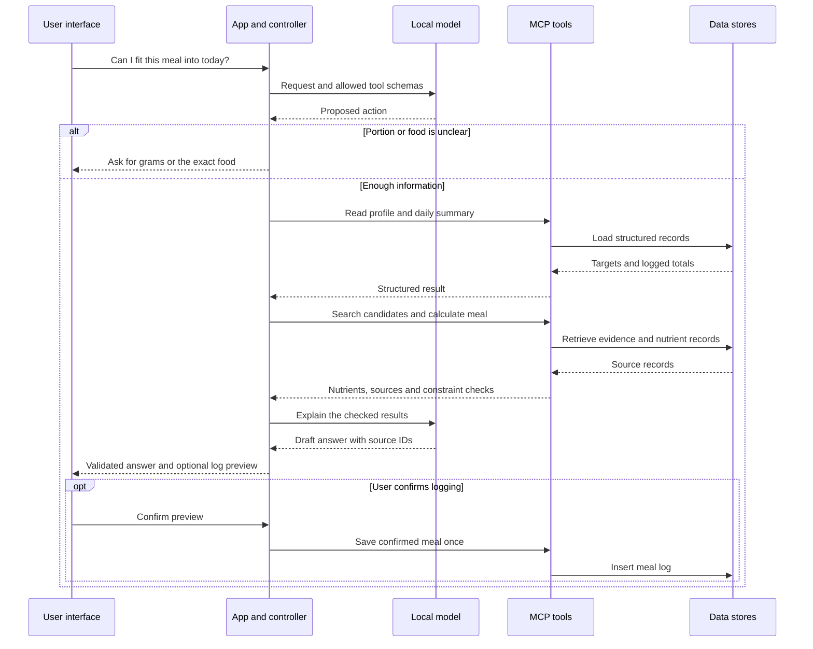

# Milestone 2: Architecture and Project Plan

**Project:** GePeTo - LLM-Powered Nutrition Assistant  
**Date:** 3 November 2026  
**Status:** Proposed design, based on our RFC. The implementation and experiments below are planned work; we are not reporting results yet.

## 1. What we want to build

Our app will help users log food and decide what to eat next. A user should be able to ask “Does this meal fit my day?” and get a short answer that considers their targets, previous meals and preferences. This follows the scope of our RFC: profiles, food logging, calorie and macronutrient tracking, and basic recommendations.

For the first version, we will support English text input and quantities in grams. The interface will have a profile form, a daily food diary and a chat. We will use a small recipe collection for suggestions.

Our main design choice is to keep calculations separate from text generation. Python will calculate portions and daily totals from stored values. The language model will select tools and explain their results. This should make incorrect numbers easier to detect and fix than if we asked the model to do everything.

## 2. Data and ingestion

### Initial dataset

We will use **USDA FoodData Central, SR Legacy, April 2018**, available as a downloadable CSV dataset. We chose this fixed release because it provides a reproducible starting point with food identifiers and nutrient values. It is not a current catalogue of Romanian supermarket products. FoodData Central publishes its data under CC0.

We will start with a documented selection of **300 foods** across meat, dairy, grains, legumes, fruit, vegetables, oils and common snacks. The selection script and list of source IDs will be committed, so the subset is reproducible. We will also write **30 simple recipes**, each with ingredient IDs, gram quantities, preparation steps and a serving count. Recipe nutrients will be calculated from the ingredients and marked as estimates.

Each food record will keep its source ID, description, preparation state, calories, protein, carbohydrates and fat per 100 g, source version and import date. Missing values will stay `null`, not become zero. We will keep raw and cooked foods separate. A recipe will specify whether ingredient weights are raw or cooked; a final cooked weight will be required if the user wants to log it by cooked grams rather than servings.

### Adding new data

The importer will accept FoodData Central CSV files and our own food/recipe JSON format. A manually entered packaged food will require a name, label values, units and source note. It will remain marked as user-entered data.

The import process will:

1. Validate required fields, units and non-negative quantities, and report rejected rows.
2. Normalize nutrient values to 100 g. Convert a serving only when its gram weight is known.
3. Insert or update records by source and source ID, comparing a content hash to skip unchanged records.
4. Create searchable text cards and update their embeddings. Remove superseded chunks and rebuild the small keyword index.

We will publish an index version only after its SQL records and both search indexes are ready. Until then, the app will use the previous version. Imports should be repeatable without creating duplicates. Meal logs will retain the food version and nutrient snapshot used when they were saved, so an import does not silently change yesterday's totals.

Profiles and meal logs will stay in SQLite, outside the shared retrieval corpus. Evaluation will use fictional profiles. Real personal data, model weights and generated databases will not be committed to GitHub.

## 3. Proposed architecture

We chose **Streamlit** so we can spend more time on retrieval and evaluation than on frontend development. **FastAPI** will hold the chat endpoint, input validation and agent controller. Keeping it separate lets us test the backend without clicking through the interface. This is a local prototype: the UI, API, MCP server and model runner can run on the same machine.

**SQLite** will be the source of truth for profiles, food versions, recipe ingredients and meal logs. **Chroma** will store embeddings, text and source metadata. Its persistent client and metadata filters suit a small local project. BM25 will provide a second way to search the same text cards, using exact words.

Profile setup will offer a deterministic target estimate using Mifflin-St Jeor resting energy expenditure, a configurable activity factor and goal adjustment. We will label the result as an estimate and allow users to edit calorie and macro targets. If an input required by the equation is missing, the user can enter targets manually. The language model will not invent or silently change targets. This is a general food-tracking prototype, not a system for prescribing clinical diets.

### Example request flow

Asking about a food will not automatically log it. The app will return a clarification if the food or portion is ambiguous. Before showing a recommendation, it will check ingredient restrictions and verify its numeric fields against the tool results. If this validation fails, it will show the checked calculation with a simple template instead.

## 4. RAG design

### Chunking and embeddings

For food records, we will create **one short text card per food**, including its name, preparation state, category and per-100-g values. Different foods will never be merged into one chunk. For recipes, we will preserve the ingredient list as a unit and split longer instructions at step boundaries. Each chunk will keep its recipe ID and title; retrieving a recipe will load its complete structured ingredient list before calculating or checking restrictions.

Our starting limit will be **200 tokens per chunk**, measured with the embedding tokenizer, including the title. Longer instruction text will have about **30 tokens of overlap**. Short food cards will remain intact. Oversized ingredient lists will be retrieved through a compact recipe summary and expanded by recipe ID rather than cut in the middle.

We will use **`sentence-transformers/all-MiniLM-L6-v2`**, which produces 384-dimensional embeddings and truncates inputs beyond 256 word pieces by default. The small chunks avoid that truncation. It is a reasonable first choice for our English prototype; we will measure retrieval quality instead of assuming that a larger embedding model is necessary. We will use normalized embeddings and cosine distance in Chroma.

### Hybrid retrieval

We will use **hybrid RAG**, combining dense retrieval with BM25 keyword search. Dense retrieval helps match the meaning of a request, while BM25 helps find exact food and ingredient names. This combination fits our dataset because users may describe a meal in different words or ask for a specific ingredient.

The system will retrieve ten dense and ten BM25 candidates, merge their ranks with reciprocal rank fusion, and keep five unique results. Each list contributes `1 / (60 + rank)` to a candidate's score, using ranks starting at 1. Recipe matches will be expanded to their complete records and duplicate recipes removed before generation. We will evaluate this hybrid pipeline using the Golden Dataset.

Restrictions will be applied through metadata and checked again against complete ingredient records. Missing allergen information will not count as proof that a food is suitable. Numeric conditions, such as “under 600 kcal,” will be checked in Python rather than treated as semantic similarity.

The prompt will contain the question, relevant profile fields, daily totals, tool results and retrieved source IDs. Answers should cite the records they use. Retrieved text will be treated as data, not as instructions. If no supported candidate meets the request, the app should say so or ask the user to relax a constraint.

## 5. Agent and MCP tools

We will implement **one agent with a bounded tool loop**, rather than multiple specialized agents. It will decide whether the user wants to search for food, calculate a meal, view their day, request a suggestion or change a preference. It will also decide when clarification is needed and whether another search would help.

The controller will accept only schema-valid actions from an allowlist, with at most six tool calls per request. A malformed action gets one repair attempt; repeated failures or timeouts return a clear message. User confirmation will be handled by the application, so the model cannot approve its own writes.

| MCP tool | Main inputs | Result or effect |
| --- | --- | --- |
| `get_profile` | None; session supplies the user | Targets, preferences and restrictions. |
| `get_daily_summary` | Local date | Logged meals and calculated totals. |
| `search_foods` | Query, filters, limit | Food candidates with IDs, preparation state and sources. |
| `search_recipes` | Query, restrictions, limit | Retrieved recipes with source IDs; final nutrient checks remain deterministic. |
| `calculate_meal` | Food IDs and grams, or recipe ID and servings | Calories and macros, unknown fields, and rule checks. No write. |
| `log_meal` | Validated preview ID, application confirmation token, request ID | Save the confirmed meal; repeated request IDs cannot duplicate it. |
| `update_preferences` | Validated change and application confirmation token | Save an explicitly confirmed preference, such as disliking mushrooms. |

We will expose these Python functions through the **official MCP Python SDK**, using JSON schemas and structured JSON results. FastAPI will act as the MCP host/client and start the server as a local subprocess over **stdio**. MCP standardizes access to our tools; the model still needs our controller to interpret and validate its proposed actions.

The server will derive the user from the trusted session instead of accepting an arbitrary user ID from the model. Tool errors will distinguish missing data, invalid quantities and unavailable services. Dataset imports will be a separate developer command, not a chat tool.

## 6. Model choice

We will use **Qwen2.5-3B-Instruct** as the language model, running a quantized version locally through Ollama. Its small size makes local deployment practical for our project, and its support for structured output fits the JSON actions expected by our agent controller.

The model will interpret requests, select tools and write short explanations from their results. Calculations and validation will remain in Python. We will record the exact model version, quantization and prompt settings so the project can be reproduced. We will test whether it selects the correct tools, follows user restrictions and uses the supplied food records correctly.

## 7. Golden Dataset and evaluation

We will create **60 manually reviewed cases** in `evaluation/golden.jsonl`: ten each for food lookup, portion calculations, daily summaries, constrained suggestions, preference changes, and ambiguous/unsupported requests. Some will be short multi-turn conversations. Each case will include a fictional starting profile and diary, the question, expected facts or acceptable recipe IDs, relevant source IDs, required/forbidden actions and expected database changes.

One team member will draft a case and another will check it against the frozen source data and calculate numeric answers independently. An LLM may suggest question wording, but its output will not be the reference answer. Recommendation questions can have several valid answers; we will score whether the chosen recipe meets the constraints and whether its explanation is supported.

We will split the cases into **36 development cases and 24 held-out cases**, with six and four from each category. Paraphrases and variants of the same scenario will stay in the same split. The reference answers will never be embedded in the retrieval corpus. We will freeze the split in Week 7 and use development cases for prompt and retrieval changes. The held-out set will be run after configuration selection in Week 12. Later fixes and reruns will be labelled as such, rather than described as a fresh unseen test.

### Example cases

These numbers and IDs are **synthetic test fixtures**, not claimed USDA measurements. The completed dataset will also contain cases linked to actual imported records.

| Question and starting state | Expected answer or behaviour |
| --- | --- |
| “What are the calories and protein in 200 g of `test_food_01`?” Fixture: 165 kcal and 31 g protein per 100 g. | 330 kcal and 62 g protein, citing the fixture record. |
| “How many calories do I have left?” Target: 2,000 kcal; logged: 1,450 kcal. | 550 kcal remaining; do not change the diary. |
| “Suggest a vegetarian dinner below 600 kcal with at least 25 g protein.” Fixture recipe A: 520 kcal/30 g, vegetarian; B: 650 kcal/35 g; C: 480 kcal/32 g, contains chicken. | Suggest A. B fails the calorie constraint and C fails the dietary constraint. |
| “I ate a bowl of rice.” No weight or preparation state supplied. | Ask for portion size and whether it was cooked; do not invent a precise total or save a meal yet. |
| “I dislike mushrooms; remember that.” Then confirm the change and request dinner. | Save the preference only after confirmation; exclude mushroom recipes in the later answer. |
| “How much vitamin D is in `test_food_02`?” That nutrient is missing. | Say that the value is unavailable; do not return zero. |

### Evaluation procedure

We will test the hybrid RAG pipeline and Qwen2.5-3B-Instruct on the development cases, fix incorrect retrieval, tool calls and unsupported answers, then freeze the configuration for the held-out evaluation in Week 12. The experiments will cover portion calculations, ambiguous inputs, dietary restrictions, preference updates and newly imported foods. We will record expected and actual results and explain the main failures.

We will report:

- **Retrieval Recall@5:** the fraction of annotated relevant source records retrieved in the first five results, averaged over cases that need retrieval. Chunks will be mapped back to source records.
- **Numeric correctness:** percentage of numeric cases with all required values within 1 kcal and 0.1 g of the independently calculated reference, allowing display rounding.
- **Task success:** correct tool use, expected state changes, satisfied constraints and appropriate clarification. Recommendation quality will also be reviewed manually.
- **Grounding:** whether factual claims are supported by cited records, including checks for invented sources and missing-data claims.

Our initial goals are at least **80% Recall@5**, **95% numeric correctness** and **80% task success** on applicable held-out cases, with **zero unconfirmed writes or prohibited-ingredient recommendations in the test set**. These are targets, not measured results or guarantees outside that set. We will publish raw counts as well as percentages because 24 held-out cases are a small sample.

## 8. Week-by-week implementation plan

The dates below follow the FMI/UBB 2026-2027 calendar. We are currently in **Week 6**. Week 12 ends before the Christmas break, and Weeks 13-14 take place in January. Exact submission/presentation slots remain those set in class.

| Week | Dates | Work and experiments | Evidence to commit by the end of the week |
| --- | --- | --- | --- |
| **6 - Milestone 2** | **2-8 Nov 2026** | Finalize architecture, dataset choice, evaluation design and scope. | This document and diagrams in `docs/`; implementation tasks with owners. |
| **7** | **9-15 Nov** | Set up the Python app, SQLite schema and importer. Select 300 foods, write 30 recipe records and freeze 60 reviewed evaluation cases. Smoke-test local model loading. | Import script, source manifest, small fixtures, golden dataset/split and basic validation tests. |
| **8** | **16-22 Nov** | Implement profile/target setup, diary and nutrient calculations. Expose core MCP tools and connect the UI. Run deterministic numeric and duplicate-write tests. | Working form-based logging flow, MCP server, tool schemas and test output. |
| **9** | **23-29 Nov** | Build Chroma and BM25 indexes with 200-token chunks and implement hybrid retrieval. Check whether development questions retrieve the expected food and recipe records. | Hybrid retrieval code, rebuild instructions and retrieval correctness results. |
| **10** | **30 Nov-6 Dec** | Connect bounded agent routing, clarification and confirmed writes. Integrate Qwen2.5-3B-Instruct with hybrid RAG and test complete user conversations. | End-to-end chat flow, sanitized tool traces and development test results. |
| **11** | **7-13 Dec** | Test restrictions, unsupported questions, preference changes and import updates. Fix incorrect answers and tool calls, then freeze the demo configuration. | Correctness test results, resolved issues, failure examples and frozen configuration. |
| **12 - Progress review** | **14-20 Dec** | Run frozen held-out evaluation, fix demonstration blockers and prepare a reproducible local demo. | Working prototype, setup guide, evaluation report/raw outputs and a tagged progress version. Any post-test fixes and reruns are recorded separately. |
| Christmas break | 21 Dec 2026-3 Jan 2027 | Buffer for optional cleanup; no essential feature depends on holiday work. | Optional fixes only. |
| **13** | **4-10 Jan 2027** | Address feedback, improve the most common failures and check installation from a clean checkout. | Tracked fixes, labelled regression results and final demo script. |
| **14 - Final presentation** | **11-17 Jan 2027** | Present the system, experiments, trade-offs and remaining limitations. | Final report, presentation materials and tagged final version. |

We will assign owners for data/evaluation, backend/tools and interface/integration in GitHub issues during Week 6; one person may own more than one area. Each week will include an integration check and small, meaningful commits tied to these deliverables. The Week 12 review should show the implementation developing over time, not a single upload at the end.

The main risks are limited hardware, ambiguous food entries and over-scoping the interface. If we fall behind, we will reduce interface polish and defer extra recipe features. Profiles, reliable logging, MCP tools, one working RAG path and reproducible evaluation remain the core commitment. We will report any remaining incorrect answers and limitations honestly.
